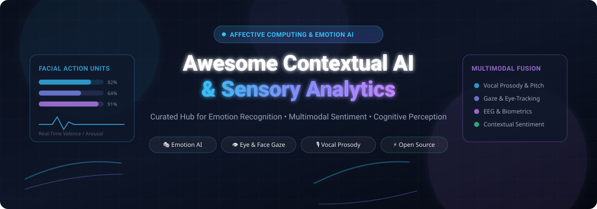

  

# 🧠 Awesome Contextual AI & Sensory Analytics 👁️🎙️

  <strong>Curated Directory of Contextual AI, Emotion Recognition, Affective Computing & Multimodal Sensory Analytics</strong>

  
  
  
  
  
  

  <a href="#-sector-overview--market-dynamics">Sector Overview</a> •
  <a href="#-saashosted-platforms">SaaS Platforms</a> •
  <a href="#-open-source-github-projects">Open-Source Projects</a> •
  <a href="#-how-to-contribute">Contribute</a> •
  <a href="#-support--sponsorship">Support</a> •
  <a href="#-star-history">Star History</a>

---

## 📌 Introduction & Scope

Welcome to the definitive curated index of **Contextual AI & Sensory Analytics** resources, frameworks, tools, and enterprise SaaS platforms. 

**Contextual AI and Sensory Analytics** encompass computer systems and machine learning models capable of sensing, processing, perceiving, and understanding nuanced human behavioral signals in real-time. By analyzing multimodal inputs—including **facial action units (FACS)**, **eye-gaze coordinates**, **vocal prosody & tone**, **physiological biometric signals (EDA, EEG, PPG, Heart Rate)**, and **contextual natural language**—these technologies reconstruct emotional states, cognitive load, user attention, valence, arousal, and intent.

### 🎯 Key Applications
- 🚗 **Automotive & In-Cabin Sensing**: Driver monitoring systems (DMS), fatigue detection, alertness tracking, and occupant comfort optimization.
- 🔬 **UX Research & Consumer Neuroscience**: Webcam eye-tracking, heatmaps, subconscious emotional response scoring, and A/B ad testing.
- 🏥 **Healthcare & Wellbeing**: Mental health diagnostics, non-verbal patient assessment, neurodivergent communication assistance, and clinical biofeedback.
- 📞 **Contact Centers & Conversational Intelligence**: Real-time agent guidance, customer frustration detection, and empathetic voice AI.

---

## 📈 Sector Overview & Market Dynamics

The global **Emotion AI and Affective Computing market** is estimated between **$95B and $112B in 2025**, projected to surpass **$140B by 2026** at an accelerating 25–30% CAGR. 

The sector remains **moderately fragmented and highly specialized** rather than a winner-take-all monopoly:
- **Cloud & Productivity Giants**: Embedding contextual sensing into large SaaS suites and enterprise CRM workflows (e.g., Zoho, Microsoft).
- **Vertical Automotive OEMs & Tier-1 Suppliers**: Focusing on high-reliability, edge-computed in-cabin driver monitoring systems (DMS) under strict safety regulations (e.g., Smart Eye / Affectiva).
- **Consumer Neuroscience Labs**: Supplying cloud and browser-based facial coding, webcam eye-tracking, and neuromarketing panels (e.g., Realeyes, Entropik, Element Human).
- **Empathic Voice & Multimodal Foundation Model Startups**: Pioneering expressive speech-to-speech interaction and conversational prosody (e.g., Hume AI).

---

## ☁️ SaaS/Hosted Platforms

| Product | Scale (Valuation / Revenue) | Description | Pricing (Starting Tier) | Free Tier / Trial Limits |
|---|---|---|---|---|
| **[Zoho Sense / Zia](https://www.zoho.com/)** | ~$12B valuation / $1.5B+ annual revenue | Contextual behavioral analytics and conversational AI intelligence embedded across the Zoho enterprise suite. | $40/user/month (Enterprise CRM with Zia predictive AI) or PageSense from $20/month | **Forever Free Plan**: 5,000 monthly tracked visitors, 1-month retention, unlimited heatmaps/recordings up to 5k/month (PageSense); Zia developer tier provides monthly free token allowances |
| **[Hume AI](https://www.hume.ai/)** | ~$225M valuation ($80M+ funding) / ~$5M revenue | Multimodal empathic AI platform featuring Empathic Voice Interface (EVI), expressive TTS (Octave), and facial/vocal expression measurement APIs. | $14/month (Creator tier) or Pro at $70/month; usage-based at $0.036/min (EVI) | **Forever Free Tier**: 5 EVI conversation minutes/month, 10,000 TTS characters/month, 1 concurrent connection, unlimited voice cloning |
| **[Entropik Tech](https://www.entropik.io/)** | ~$150M valuation ($35M funding) / ~$5.5M annual revenue | Integrated Emotion AI research platform (Decode / Qatalyst) with webcam eye-tracking, facial coding, and voice tone measurement. | Custom enterprise contract (approx. $10,000+/year billed annually) | **Forever Free Core Tier**: 100 participant responses/month, 1 researcher seat, up to 3 studies, 5 AI creative prediction scans, limited Emotion AI responses |
| **[Affectiva (Smart Eye)](https://www.affectiva.com/)** | $73.5M acquisition value (~$5M revenue at acquisition) | Emotion AI and facial expression analysis pioneer for automotive driver monitoring, UX, and media research (integrated with iMotions). | $25,000/year (commercial edge SDK license) or batch cloud API usage per minute | **No forever free tier**; 30-day evaluation trial available for academic/commercial SDK testing upon sales request |
| **[Realeyes](https://www.realeyes.com/)** | ~$50M valuation ($33M+ funding) / ~$12M annual revenue | Human attention, eye gaze, and facial coding analytics platform measuring audience engagement and attention metrics for advertising and video. | Enterprise contract starting at $15,000–$25,000/year; self-serve webcam partner tier (RealEye.io) starts at $390/month | **No forever free tier**; 7-day limited free trial (via RealEye evaluation) or custom demo upon sales qualification |
| **[Sightcorp (Raydiant)](https://sightcorp.com/)** | Acquired by Raydiant ($30M+ funding / ~$15M revenue) | Computer vision engine for real-time anonymous facial analysis, audience demographics, dwell time, and emotional reaction for digital signage. | $49/screen/month (annual prepay) or $59/screen/month (Raydiant In-Store Experience Platform + Sightcorp) | **No forever free tier**; 14-day free trial of Raydiant platform with analytics demo available on request |
| **[Empath (WebEmpath)](https://webempath.com/)** | Seed-stage (~$3M funding) / ~$2M–$3M annual revenue | Speech emotion recognition API that identifies 4 primary emotions (joy, sorrow, anger, calm) and vigor in real time from vocal acoustic properties. | Custom enterprise tier / contact sales (domestic & international API contracts) | **No forever free tier** (legacy free API discontinued Oct 2026); custom pilot trial provided upon partner registration |
| **[Element Human](https://www.elementhuman.com/)** | Seed-stage (~$3.4M funding) / <$3M annual revenue | Human experience and sensory measurement suite capturing facial coding, eye-gaze, and brand response metrics for creative testing. | $1,995/credit per single study (or $1,695/credit on annual commitment) | **No forever free tier**; interactive sandbox demo and trial study scoping available through sales consultation |
| **[MorphCast](https://www.morphcast.com/)** | Seed-stage (~$2M funding) / <$2M annual revenue | Client-side, browser-based Emotion AI HTML5 SDK delivering privacy-first real-time facial expression analysis without sending video to cloud. | $199/month (Minimal tier, includes 50 stream hours/month; overage ~$0.10/min) | **60-day free trial** across self-serve tiers via Stripe checkout (or free non-commercial license upon academic verification) |
| **[Sensum](https://www.sensum.co/)** | Inactive / Deadpooled (~$1.5M historical funding) | Early pioneer in biometric sensor fusion combining wearable physiological data (EDA, heart rate, EEG) with facial expression analytics. | N/A (Defunct / corporate operations discontinued) | **No active tier** (Historical operations deadpooled) |

---

## 💻 Open-Source GitHub Projects

| Project | Stars_Badge | Description |
|---|---|---|
| **[DeepFace](https://github.com/serengil/deepface)** |  | Lightweight facial recognition and facial attribute analysis library for Python. Performs real-time emotion recognition (angry, fear, neutral, sad, disgust, happy, surprise) along with age, gender, and race detection. |
| **[OpenFace](https://github.com/TadasBaltrusaitis/OpenFace)** |  | State-of-the-art open-source facial behavior analysis toolkit. Capable of facial landmark detection, head pose tracking, eye-gaze estimation, and facial Action Unit (AU) recognition for affective computing. |
| **[face_classification](https://github.com/oarriaga/face_classification)** |  | Real-time face detection and emotion/gender classification using FER-2013 and IMDB datasets with Keras CNN architecture and OpenCV video pipelines. |
| **[FER](https://github.com/justinshenk/fer)** |  | PyPI-installable Python package for Facial Expression Recognition using deep convolutional neural networks. Extracts 7 universal emotion percentages directly from video or static frames. |
| **[Py-Feat](https://github.com/cosanlab/py-feat)** |  | Python Facial Expression Analysis Toolbox. Comprehensive suite for detecting facial landmarks, emotions, muscle action units (FACS AUs), and head poses with built-in preprocessing and plotting utilities. |
| **[CMU-MultimodalSDK](https://github.com/CMU-MultiComp-Lab/CMU-MultimodalSDK)** |  | Carnegie Mellon MultiComp Lab's toolkit (`mmdatasdk`) for managing, downloading, and temporally aligning multimodal time-series datasets (audio, visual, text) for affective computing benchmarks like CMU-MOSI and CMU-MOSEI. |
| **[Emolysis](https://github.com/ControlNet/emolysis)** |  | Multimodal open-source group emotion analysis and visualization toolkit. Processes synchronized multimodal video feeds and maps to group-level emotional valence and arousal with a cross-platform GUI. |
| **[ERML](https://github.com/sid-lakhani/erml)** |  | Pip-installable Python SDK for facial emotion recognition. Analyzes images for 7 basic emotions using lightweight FER-2013 architectures, natively returning structured JSON data for AI agents. |
| **[BehaviorKit](https://github.com/IUB-RHouse/BehaviorKit)** |  | Plug-and-play multimodal behavior analysis toolkit for robotics. Bundles real-time gaze tracking, ASR transcription, textual sentiment, valence & arousal estimation, and facial landmarks over WebSockets. |
| **[GExSent](https://github.com/Subhanshusethi/GExSENT-MOE)** |  | Multimodal sentiment analysis framework leveraging CLIP, Modern BERT, and Hierarchical Gated Mixture of Experts (MoE) for robust text-audio-visual sentiment classification. |

---

## 🤝 How to Contribute

Contributions are warmly welcomed! Please help expand and refine this ecosystem:

1. 🍴 **Fork the repository** to your own GitHub account.
2. 🌿 **Create a feature branch** (`git checkout -b add-awesome-tool`).
3. 📝 **Add or update entries in [README.md](file:///C:/Users/ishan/Documents/Projects/Awesome-Contextual-AI-Sensory-Analytics/README.md)** matching the existing table structure:
   - For SaaS: Include company scale/valuation, specific starting pricing, and exact free tier/trial limits.
   - For Open-Source: Include the social white Stars_Badge linking to `/stargazers`.
4. 🚀 **Submit a Pull Request** with a brief summary explaining the tool's relevance to contextual AI & sensory analytics.

---

## ☕ Support & Sponsorship

If you find this curated collection helpful for your research, team, or projects, please consider supporting the project:

- ⭐ **Star this repository** to help others discover it on GitHub.
- 🍴 **Fork and share** with colleagues in affective computing, UX research, and AI perception.
- ☕ **Buy a coffee & sponsor**: You can sponsor ongoing maintenance and development via the [GitHub Sponsors Dashboard](https://github.com/sponsors/ishandutta2007).

Thank you for supporting open contextual AI knowledge and research! 🙌

---

## 📊 Star History

---

## ⚠️ Disclaimer

- This is an independent, **community-curated** list — inclusion does not represent an endorsement.
- Sensory analytics technologies process biometric, vocal, and facial data, which are subject to strict privacy frameworks (GDPR, EU AI Act, CCPA, BIPA). Always ensure informed participant consent, data minimization, and regulatory compliance before deploying emotion recognition systems.
- Commercial platform pricing and quotas are subject to change by respective vendors.
